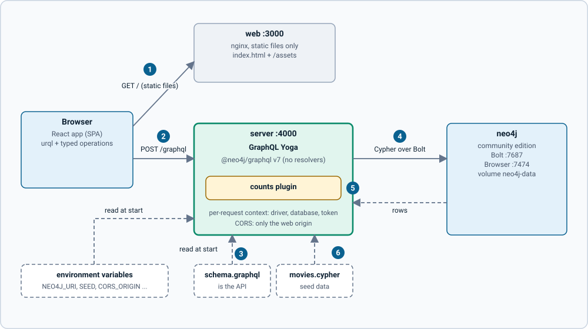
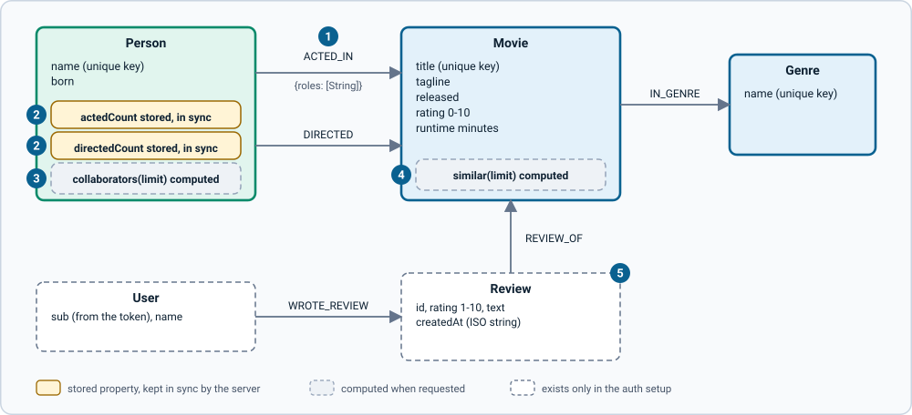
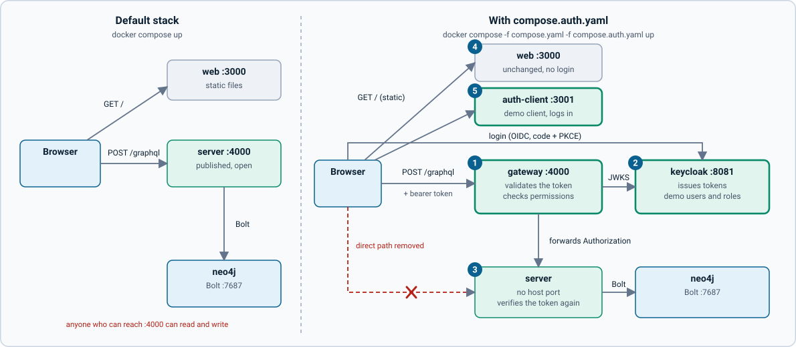
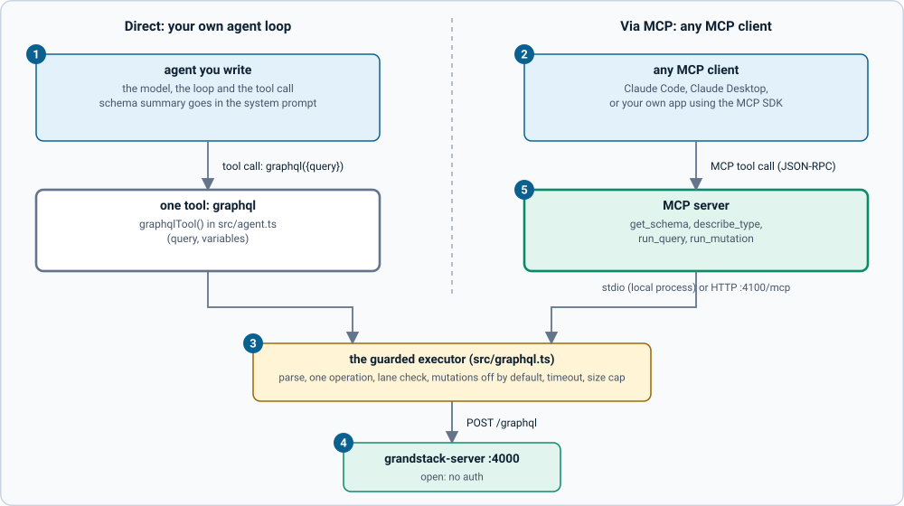

# Architecture

GRANDstack is a way to build apps on a Neo4j graph with GraphQL: a Neo4j database, a GraphQL server generated from a schema file, and a React client with typed operations. The **A** now stands for **Agent**: the same GraphQL API that serves the web app is meant to serve coding agents and agentic apps too. Apollo has been removed; the pieces are Neo4j's GraphQL library, GraphQL Yoga and open-source libraries that run locally in Docker.

This guide describes what is built today (the versions that were tested together are in [versioning and releases](versioning-and-releases.md)). What is planned is on the [roadmap](roadmap.md).

## Components

*Figure: the default stack. The browser gets static files from one container and talks to the GraphQL server directly. Click the image for full size; the numbered notes below carry the same information as text.*

1. **Static files only.** The `web` container serves the built app with nginx (falling back to `index.html` for client-side routes). It never calls the server.
2. **Direct GraphQL.** The browser POSTs to `http://localhost:4000/graphql`. That URL is fixed when the web image is built (`VITE_GRAPHQL_URL`), and the server's `CORS_ORIGIN` must allow the web origin.
3. **The schema file is the API.** `schema/schema.graphql` and the environment variables are read once at start. There are no resolvers to write.
4. **Cypher over Bolt.** `@neo4j/graphql` translates each request into Cypher and runs it on the one database (`neo4j`; community edition has a single database).
5. **Counts plugin.** After every mutation the server recalculates the stored film counts on people, before it replies, so a refetch is correct.
6. **Seed on start.** The Movies seed is loaded into an empty database, or reloaded when the seed file's version is newer; data the server did not load is left alone.

- The **browser** loads the static app from `web` (port 3000) and sends GraphQL requests **directly** to `server` (port 4000). `web` does not proxy; the server allows the web origin with CORS.
- The **server** has no resolvers. It reads `schema/schema.graphql`, and `@neo4j/graphql` generates the API and translates each request into Cypher.
- **Neo4j** holds the data. Port 7474 serves Neo4j Browser (user `neo4j`, password from `.env`).

| Repository | Role | Documentation |
| --- | --- | --- |
| `grandstack` (this one) | Compose stack, overview, tutorial, agent guide | here |
| `grandstack-server` | The GraphQL server image | `docs/` in that repo |
| `grandstack-web` | The React app (open, no login) | `docs/` in that repo |
| `grandstack-auth` | Optional: gateway, Keycloak dev realm, auth rules, demo client | `docs/` in that repo |
| `grandstack-federation` | Optional: gateway and supergraph, Wikipedia subgraph | `docs/` in that repo |
| `grandstack-web-aura` | Optional: a web UI for managing Neo4j Aura (the Aura model, subgraph, web app, fake Aura, edge) | `docs/` in that repo |

## Data model (the sample)

*Figure: the sample data model. Dashed boxes exist only in the auth setup. Click the image for full size; the numbered notes below carry the same information as text.*

1. **Roles live on the relationship.** `ACTED_IN` carries a `roles` list as a relationship property. Titles and names are unique keys (constraints), so there are no ids.
2. **Stored but derived.** `actedCount` and `directedCount` are real properties so people can be sorted and filtered in plain GraphQL; the counts plugin keeps them correct.
3. **Computed on request.** `Person.collaborators` runs a Cypher traversal ranked by shared films and returns a name and a count. It cannot be sorted or filtered.
4. **Computed on request.** `Movie.similar` scores films by shared director (3 points), cast (2) and genre (1).
5. **Auth setup only.** `Review` and `User` come from `grandstack-auth`'s schema extension. A review's author is taken from the token.

- **Movie**: `title` (unique), `tagline`, `released`, `rating` (0 to 10), `runtime` (minutes).
- **Person**: `name` (unique), `born`, and the stored counts `actedCount` and `directedCount`.
- **Genre**: `name` (unique).
- `ACTED_IN` carries the character names as `roles`.
- Computed fields in the schema: `Movie.similar` (shared director, cast and genres) and `Person.collaborators` (shared films).
- 152 films, 464 people and 18 genres are bundled. The titles, casts and relationships are real; ratings and runtimes are approximate sample data.

The full field list is generated from the schema in `grandstack-server/docs/schema-reference.md`.

## A request, end to end

Example: the user ticks the Drama genre on `/movies`.

1. The React app updates the URL (`/movies?g=Drama`). The URL is the single source of truth for filters.
2. `buildWhere` turns the filters into a GraphQL `MovieWhere`, and urql sends the typed `Results` operation to `POST /graphql`.
3. Yoga builds the request context (driver, database, options) and runs the operation.
4. `@neo4j/graphql` translates it to Cypher, runs it on Neo4j, and shapes the rows into the response, including genre and decade counts computed with the *other* filters applied.
5. The component renders typed data. If it was a mutation, a server plugin first recalculates the stored film counts, so the refetch is correct.

## Authentication (opt-in)

The default stack above is open. Adding `compose.auth.yaml` puts a gateway in front of the server and adds Keycloak and a demo client:

*Figure: what `compose.auth.yaml` changes. New services are outlined in bold; the red dashed path is the one that disappears. Click the image for full size; the numbered notes below carry the same information as text.*

1. **Gateway in front.** It becomes the public GraphQL endpoint on port 4000, validates every token and checks permissions per mutation, then forwards the `Authorization` header.
2. **Keycloak beside it.** It logs users in (OIDC code + PKCE) and signs tokens; the gateway and the server fetch its public keys (JWKS).
3. **Server no longer published.** The browser can no longer reach it directly. It also verifies the token again and applies row-level rules.
4. **`grandstack-web` unchanged.** It still calls port 4000, which is now the gateway, so it acts as an anonymous client: reads work, writes are refused.
5. **Demo client added.** `auth-client` on port 3001 logs in and shows the rules at work.

- **Reads are public; writes need a login.** Roles `user`, `editor`, `moderator` map to permissions at the gateway and to row rules on the server (only a review's author or a moderator can change it).
- **Two independent checks:** the gateway answers "may this token call this mutation?"; the server answers "may it change this row?" and refuses unauthenticated writes even if reached directly.
- The server stays auth-agnostic: it only gets generic settings (`AUTH_*` to verify tokens, `SCHEMA_EXTRA_PATHS` to load extra schema). The `User` and `Review` types and every rule live in `grandstack-auth` and are mounted in.
- **`grandstack-web` is deliberately unchanged.** Through the gateway it is an anonymous client: reading works, writing is refused. Adding login to it is a documented exercise in `grandstack-auth`.
- Details, roles, responses and what to change for production: the `grandstack-auth` repository's `docs/how-it-works.md`.

## Agents (opt-in)

`compose.agents.yaml` adds one service, `agents-mcp` on port 4100: an MCP server that accepts GraphQL statements and runs them against the server. An agent can also skip MCP and send GraphQL itself; both paths share one guarded executor.

*Figure: the two agent paths. Click the image for full size; the numbered notes carry the same information as text.*

1. **An agent you write** holds the model, the loop and one `graphql` tool.
2. **Any MCP client** (Claude Code, Claude Desktop, your own app) lists and calls the tools.
3. **The guarded executor** parses the statement, allows one operation, keeps queries and mutations apart, refuses mutations unless `ALLOW_MUTATIONS=true`, and applies a timeout and a size cap.
4. **The server** is the open `grandstack-server`; nothing about it changes.
5. **The MCP server** offers `get_schema`, `describe_type`, `run_query` and `run_mutation` over stdio or HTTP.

- Read-only by default. That flag guards the MCP path only; the server on port 4000 stays open. Real control is auth: `grandstack-agents/docs/adding-auth.md` shows the same tools using `grandstack-auth` with a token.
- The tools use introspection and know nothing about movies, so they work with another GraphQL server.
- Details: the `grandstack-agents` repository's `docs/how-it-works.md`.

## Federation (opt-in)

`compose.federation.yaml` turns the server into a federation subgraph, adds a Wikipedia subgraph, and puts a gateway on port 4000 that serves one combined API. The Neo4j subgraph moves to port 4001.

*Figure: the federation setup. Click the image for full size; the numbered notes carry the same information as text.*

1. **Clients** (`grandstack-web`, agents, curl) call one endpoint.
2. **The gateway** (Hive Gateway) reads the supergraph and plans each query.
3. **The supergraph** is composed from the two subgraphs by `npm run compose` and committed.
4. **The Neo4j subgraph** is `grandstack-server` with `FEDERATION=true`; Movie and Person are keyed on `wikipediaTitle`.
5. **The Wikipedia subgraph** adds `wikipedia` (description, extract, image, page link) to Movie and Person.
6. **The links file** gives films and people their Wikipedia page, set at server start.

- The Wikipedia part calls the live public Wikipedia API: it needs internet, is cached for an hour, and its text is CC BY-SA 4.0.
- A film or person with no link returns `wikipedia: null` with no error; Wikipedia trouble returns `null` with an error and the Neo4j fields still arrive.
- Open, like the default stack: combining it with auth is not built.
- Details: the `grandstack-federation` repository's `docs/how-it-works.md`.

## Aura management (opt-in)

`compose.aura.yaml` replaces the Movies app with a web UI for managing Neo4j Aura, built from the pieces above rather than beside them. It is the second example (after federation) of the same server image serving a different schema.

- **The store is `grandstack-server`**, run with `MODEL=aura` (the model, a schema and setup Cypher, is mounted from `grandstack-web-aura/models`). It runs **twice**: once with `READ_ONLY=true`, a federation subgraph that the gateway and the web app read through, and once writable, on a private network, for the Aura subgraph only. `MODEL` holds one name, so one model runs per server; the Aura setup uses its own Neo4j volume so Movies and Aura data never mix.
- **The gateway is `grandstack-federation`'s image**, with the Aura setup's own `supergraph.graphql` and gateway config mounted over its own, composing the read-only server and an **Aura subgraph** (custom code in `grandstack-web-aura`, like the Wikipedia subgraph).
- **The web app is its own web server**, which serves the app and forwards `/graphql` to the gateway, so the browser talks to one origin.
- **A fake Aura** (`mock-aura`, checked against Aura's own OpenAPI file) is the default, so no real account is touched.
- Everything is published on this machine only, with no sign-in. `compose.aura-edge.yaml` adds TLS, a sign-in and rate limits in front and publishes nothing else.
- Details, diagrams and the rules for changing things: the `grandstack-web-aura` repository's `docs/architecture.md`.

## Design decisions and why

| Decision | Reason |
| --- | --- |
| Generate the API from a schema file with `@neo4j/graphql` rather than writing resolvers | The schema is the single description of the API, which is easy for people and agents to read and change; filters, sorting and nested writes come for free. |
| GraphQL Yoga, no Apollo | The brief removes Apollo; Yoga is the Guild's lightweight server with a plugin system we use. |
| Schema and seed are mounted files, configuration is environment variables | The same image serves any data model. See [build your own app](build-your-own-app.md). |
| Seed has a version and a marker node; data it did not load is never touched | A newer seed reloads cleanly, and pointing the server at your own Neo4j never overwrites your data. |
| Film counts stored on `Person` and refreshed by a plugin after every mutation | Computed (`@cypher`) fields cannot be sorted or filtered in plain GraphQL, and a plugin keeps every client (UI, `curl`, agent) correct without knowing about it. |
| Relationship edits are sent as diffs, never "disconnect all, then connect" | In `@neo4j/graphql` v7 the disconnect runs last and removes the new links. |
| Names and titles are the keys (unique constraints), so there are no ids | It keeps the sample readable and URLs meaningful; the cost is that renames change URLs and duplicates are rejected. |
| Filters live in the URL | Results are shareable and reloadable and the back button works. |
| Posters and avatars are generated from the text | No image licensing, no assets to host. |
| Needle-style look reimplemented, `@neo4j-ndl/*` not used | Those packages are GPL-3.0 and this project is Apache-2.0. The tokens are approximations, not verified against Needle. |
| `react-force-graph-2d` for graph views | MIT-licensed; Neo4j's own NVL has a custom licence. |
| Separate repos, versioned with semver tags | Each piece can be cloned and used alone; the umbrella records which versions work together. |
| Community Neo4j, database `neo4j` | It runs locally with no licence; community supports a single database. |
| Auth as a gateway plus server rules, in its own repo, opt-in | Authentication is orthogonal to the app: the gateway can front any GraphQL server, the server stays generic, the default quickstart stays zero-config, and `grandstack-web` shows what an app looks like before login. |
| Both the gateway and the server verify the token | Defence in depth: the server is safe even if reached directly. |
| Permissions at the gateway are derived from roles | Keycloak grants OAuth scopes per client, not per user, so roles are what differ between users; the gateway also accepts `permissions` and `scope` claims for other providers. |
| Row-level `filter` rules, not `validate`; ISO strings, not `DateTime` | `validate` rules and `DateTime` reads need Neo4j's APOC plugin, which this stack does not include. |
| Reviews are created by a custom mutation using the token's `sub` | The author cannot be spoofed because clients cannot pass one; the generated create is removed. |

## Limits today

- **The default stack has no authentication.** Anyone who can reach the server can read, create, edit and delete everything. Do not expose it publicly. The opt-in auth setup is development-only too (Keycloak dev mode, demo users, plain HTTP); see `grandstack-auth` for what production would need.
- The compose file builds the server and web images from sibling checkouts; it does not pull published images yet ([versioning](versioning-and-releases.md)).
- Everything runs on one machine in Docker or Podman; there is no production deployment recipe.
