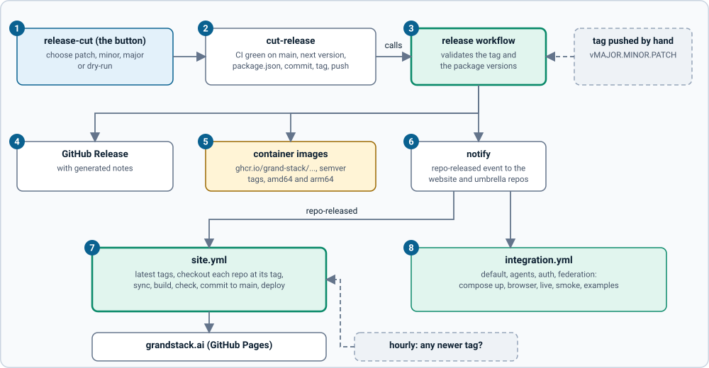

# Releasing, CI and the website

How code is checked, how a release is made, and how every release reaches grandstack.ai. All of it runs as GitHub Actions in the `grand-stack` organisation. The shared pieces live in the organisation's `.github` repository (reusable workflows tagged `v1`); each repository has small workflow files that call them.

> **Written but not yet run on GitHub.** The workflows were checked with `actionlint`, their scripts have unit tests, the integration script was run against all four compose setups, and the website job's steps were simulated locally. Nothing has run on GitHub yet, because the repositories are not pushed. Follow the [first-run checklist](#first-run-checklist) and expect to fix small things.

## On every commit and pull request

Each repository's `ci.yml` runs on pull requests and on pushes to `main`:

| Repository | What runs |
| --- | --- |
| `grandstack-server` | lint (schema lint and TypeScript), tests, docs check, build; on pull requests the GraphQL breaking-change check; a Docker build and a smoke test against a real Neo4j |
| `grandstack-web` | typecheck, tests, docs check, build, Docker build |
| `grandstack-auth` | typecheck and tests for the gateway and the client (and the client build), docs check, Docker builds |
| `grandstack-agents`, `grandstack-federation` | typecheck, tests, build, docs check, Docker build(s) |
| `grandstack` (this repo), `.github` | the docs link check (`.github`: its script tests and a workflow lint) |
| `grand-stack.github.io` | the site's unit tests, a build, and the site checks on the committed docs copy |

Every one of them also checks that **every code file has the copyright header**. A newer push cancels the still-running checks of the one before it. None of these checks blocks a merge until you mark it as required in branch protection or a ruleset. Code scanning is GitHub's CodeQL default setup (it is switched on for the organisation's repositories; results are under each repository's Security tab), a dependency review fails pull requests that add a dependency with a high-severity vulnerability (it does not check licences yet), and Dependabot proposes weekly updates for npm, Docker and Actions. Dependabot is told to leave alone the pins that must hold: `graphql` stays 16.x, `@apollo/subgraph` stays 2.14.4, and the MCP SDK stays on its v1 API.

## Making a release

Versions are semantic (`vMAJOR.MINOR.PATCH`) git tags, and the tag must equal the version in every `package.json` of the repository.

1. **The release button.** In the repository's Actions tab, run **release-cut**: choose patch, minor or major (or tick dry-run to see the next version and the change without pushing).
2. **`cut-release`** checks that CI succeeded on the tip of `main`, works out the next version from the latest tag, sets it in every `package.json` (and lock file), commits `release vX.Y.Z`, tags it and pushes. The release-cut workflow then runs the release workflow in the same run, because a tag pushed with the default token does not start other workflows. (The release commit does not get its own CI run for the same reason; the next release checks the commit before it.)
3. **The release workflow** validates the tag, that it is on `main`, and that all `package.json` versions agree with it. For a hand-pushed tag it also requires a successful `ci.yml` run on that commit. Images are tagged `latest` only when the tag is the highest release. You can start it by pushing a tag yourself (the version must already be committed) or by hand from the Actions tab with a tag and `dry-run`.
4. **GitHub Release** with generated notes.
5. **Container images**, built for `linux/amd64` and `linux/arm64` (the arm64 build is emulated and can take many minutes) and pushed to `ghcr.io/grand-stack/<image>` with the tags `1.2.3`, `1.2` and `latest`.
6. **Notify**: a `repo-released` event goes to the website repository and to this repository. If the `SITE_DISPATCH_TOKEN` secret is missing, a notice says so, the website catches up at its next hourly check, and the integration test waits for its nightly run.
7. **The website** (`site.yml`) rebuilds. See below.
8. **The integration test** runs the four compose setups against the latest `main` of every repository.

| Repository | Images |
| --- | --- |
| `grandstack-server` | `grandstack-server` |
| `grandstack-web` | `grandstack-web` |
| `grandstack-auth` | `grandstack-auth-gateway`, `grandstack-auth-client` |
| `grandstack-agents` | `grandstack-agents-mcp` |
| `grandstack-federation` | `grandstack-federation-wikipedia`, `grandstack-federation-gateway` |

The web and auth-client images carry the URLs they were built with (`VITE_GRAPHQL_URL` and the OIDC settings point at `localhost`), so a published image fits the default local setup only; to use another address, build from source with build arguments. `docker compose` still builds from the sibling folders: pinning compose to published image tags is a later step.

This repository (`grandstack`) and `.github` have no images and no `package.json`: the release button only tags. A repository's tag history is how the website and these docs name "the versions tested together" (see [versioning and releases](versioning-and-releases.md)).

## How a release reaches the website

`grand-stack.github.io` has one workflow, `site.yml`, that runs when a repository sends `repo-released`, **every hour** as a fallback, when someone pushes to its `main`, and by hand.

1. It asks GitHub for the highest `vX.Y.Z` tag of each of the six documented repositories and compares them with the versions the site was last built from (`data/versions.json`). An hourly run with nothing new stops here.
2. It checks each repository out **at that tag**, beside the site, so the docs shown are the docs of the released version.
3. It runs `npm run sync`, `hugo --gc --minify` and the site checks (links, anchors, alt text, `llms.txt`).
4. It uploads the built site, and deploys it to GitHub Pages.
5. Last, if the docs copy changed, it commits it to the site's `main` as `github-actions[bot]` ("docs: sync from releases (...)"). If the branch rules refuse the bot, this step fails (the site has already been deployed), and the hourly check will keep rebuilding until the push works, so fix the rule for `github-actions[bot]`.

Both the website and the integration test check out the other repositories with the default token, so **the repositories must be public** (or you must give the workflows a token that can read them). A repository the token cannot see makes the site job fail rather than silently use an old copy.

A release of the website repository itself is not needed: it deploys on every push.

## The nightly integration test

`integration.yml` (this repository) runs at night, after any release, and by hand. For each of `default`, `agents`, `auth` and `federation` it checks out the latest `main` of every repository, starts that compose setup, runs its checks, and tears it down:

| Setup | Checks |
| --- | --- |
| default | `grandstack-web`'s browser end-to-end checks, the website's default examples |
| agents | `grandstack-agents`' live and container checks, the agents examples |
| auth | `grandstack-auth`'s smoke and browser checks, the auth example |
| federation | `grandstack-federation`'s smoke test and the federation examples (live Wikipedia: a failure here is reported but does not fail the run) |

The logic is a script, so you can run any setup yourself, beside the other repositories: `scripts/integration.sh agents`. (On a Mac with Podman, set `DOCKER_HOST` to the machine socket first.) Running it already found a real bug: the federation links were applied before the seed on a fresh database, so the first start had none. The server now runs `SETUP_CYPHER_PATHS` after the seed.

## Scripts you can run

| Command | Does |
| --- | --- |
| `node ../.github/scripts/headers.mjs --root . --check` | Lists code files without the copyright header (omit `--check` to add it) |
| `node ../.github/scripts/next-version.mjs --bump patch` | Prints the next version from the repository's tags |
| `node ../.github/scripts/check-version.mjs --tag v1.2.3 --root .` | Checks the tag and the `package.json` versions |
| `scripts/integration.sh <setup>` | Runs one integration setup (above) |
| `node scripts/latest-tags.mjs --local ..` (in the website repo) | Shows the latest tag of each repository and whether the site is out of date |

## One-time setup (the maintainers)

None of this can be done by the workflows themselves.

- Push all repositories and `.github` to `https://github.com/grand-stack`. Push `.github` first and make it public: the other repositories' workflows call it at `v1` (a moving major tag you move after each compatible change) and fetch its scripts with the default token. Push history with `git push origin main` then `git push origin --tags`: when more than three tags are pushed at once GitHub starts no tag workflows, whereas pushing one to three old tags would start real release runs for them (which stop at the CI check, but are noise).
- Create the organisation secret **`SITE_DISPATCH_TOKEN`**: a fine-grained token (or GitHub App) with *Contents: read and write* on `grand-stack.github.io` and `grandstack`, available to every repository that releases.
- **Pages:** in `grand-stack.github.io` settings, set the source to *GitHub Actions* and the custom domain to `grandstack.ai` (with Actions-based Pages the domain is a setting; the `CNAME` file in the repository is kept for tools that read it), and enforce HTTPS once DNS is ready.
- **Branch rules:** the release button pushes a commit and a tag directly, and the site job pushes the refreshed docs copy, both as `github-actions[bot]`. If a repository's `main` requires pull requests or status checks, add `github-actions[bot]` (or a GitHub App) as a bypass actor, or those steps fail.
- **Packages:** after the first publish, set each GHCR package to public (images are linked to their repository automatically by a label).
- Enable Dependabot alerts and the **dependency graph** (dependency review needs it). Code scanning needs no workflow here: leave CodeQL's *default setup* on (adding a CodeQL workflow file as well makes both fail). Protect `v*` tags against deletion and rewriting, but do not block their creation, or the release button's tag push fails. Decide who may run the release button.

## First-run checklist

1. After the first push, run **ci** in each repository (a pull request, or the push to `main`) and fix anything that is red.
2. Run **release** by hand (Actions tab, *Run workflow*) with an existing tag and `dry-run` ticked: it validates and builds without publishing. Do not test it by pushing a tag: that is a real release.
3. Run **release-cut** with `dry-run` on the smallest repository, then for real as a patch release. Check the GitHub Release, the images, and that the website rebuilt.
4. Run **site** by hand once; run **integration** by hand once.

## When something fails

| Symptom | Cause and fix |
| --- | --- |
| "No successful ci.yml run for commit ..." | The release needs green CI on that commit. Wait for it, or re-run it, then release again |
| "package.json says version X, but the tag is Y" | Use the release button (it sets the versions), or run `npm version Y --no-git-tag-version` and commit before tagging |
| A pushed tag did not start anything | Tags pushed with the default `GITHUB_TOKEN` do not start workflows; push it yourself, or use the release button, which chains the workflows |
| "SITE_DISPATCH_TOKEN is not set" | The website was not told directly; it updates at its next hourly check. Create the secret to make it immediate |
| The site workflow fails on a checkout or tag lookup (HTTP 404) | A repository is private or does not exist yet; the default token cannot read it. Make it public |
| The site did not change after a release | Check the `site` run: the hourly check compares tags with `data/versions.json`; run it by hand. Pages must be set to *GitHub Actions* |
| Copyright header check fails | Run `node ../.github/scripts/headers.mjs --root .` and commit |
| Scheduled workflows stopped | GitHub disables schedules in repositories with no activity for 60 days; any commit or a manual run re-enables them |
